# Olá, sou o Thalles

**Tech Lead em Engenharia de Plataforma na RD Station · SRE · DevEx**

Trabalho na evolução de plataformas internas e ajudo times a entregar software com confiabilidade, segurança e menos trabalho manual. Minha experiência passa por SRE, DevTools e DevEx, conectando decisões de arquitetura à operação e à experiência de quem desenvolve.

Gosto de entender o problema antes de escolher a ferramenta. Ao definir um padrão ou planejar uma migração, considero o impacto nos times, o custo operacional e quem vai manter a solução.

## No que trabalho

- **Plataforma e arquitetura** · evolução de serviços compartilhados, decisões técnicas e alinhamento entre times.
- **Experiência de desenvolvimento** · automação de CI/CD, GitOps e padrões que facilitem a entrega de software.
- **Infraestrutura e operação** · Kubernetes, infraestrutura como código, observabilidade e segurança.
- **Adoção e evolução** · documentação útil, planejamento de migrações e redução de trabalho manual.

## Resultados

- Migração do Google Container Registry para o Artifact Registry, com limpeza de imagens antigas e redução de aproximadamente **47 TiB para 3 TiB**.
- Padronização de pipelines CircleCI e Spinnaker com lint, validação de schemas e verificações automatizadas antes do deploy.
- Criação de templates Helm unificados, com validação por JSON Schema.
- Adoção de ambientes efêmeros para testes antes de produção.

## Tecnologias no dia a dia

| Área | Tecnologias |
| --- | --- |
| Cloud e plataforma | GCP, GKE, Kubernetes, Helm, Argo CD |
| Infraestrutura e automação | Terraform, Atlantis, Ansible, Bash, Go, Python |
| Entrega de software | CircleCI, GitHub Actions, Spinnaker |
| Observabilidade | Datadog, Prometheus, Grafana, Elastic |
| Segurança e acesso | Vault, External Secrets, OIDC, IAM |

## Atividade no GitHub

<picture>
  <source media="(max-width: 600px) and (prefers-color-scheme: light)" srcset="./assets/generated/stats-card-mobile-light.svg">
  <source media="(max-width: 600px)" srcset="./assets/generated/stats-card-mobile.svg">
  <source media="(prefers-color-scheme: light)" srcset="./assets/generated/stats-card-light.svg">
  
</picture>

Atualização semanal com [galaxy-profile](https://github.com/vinimlo/galaxy-profile).

## Vamos conversar

[LinkedIn](https://www.linkedin.com/in/thallesdaniell/) · [E-mail](mailto:thallesdaniell@gmail.com) · [Medium](https://medium.com/@thallesdaniell)
